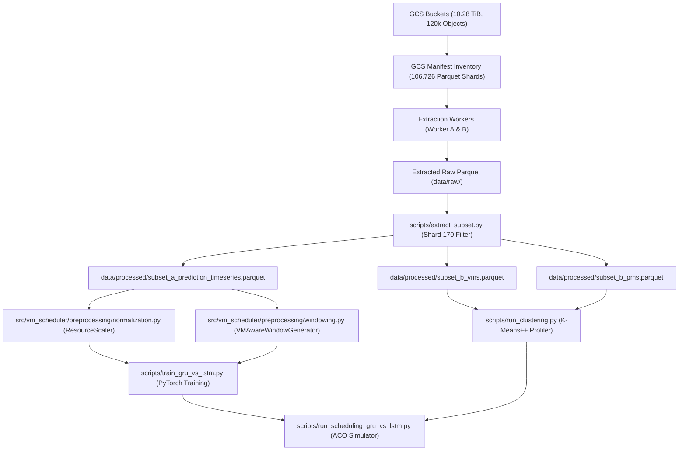

# Google Cluster Data 2019: Dataset Description, Cloud Extraction Audit, and Preprocessing Methodology

**Document Reference:** `docs/google_cluster_data_2019_dataset_and_preprocessing.md`
**Project Workspace:** `/Users/soumyaprasad/Desktop/cloud improvements`
**Git Branch:** `scientific_validation_correction`
**Commit Reference:** `6b1c95b98ee271084ba845dc401be437d5f641ad`
**Trace Source:** Google Cluster Data 2019 (May 2019 Borg Operational Telemetry)
**Primary Cloud Audit Reference:** `docs/initial_cloud_data_audit.md`

---

## 4.1 Dataset Introduction and Context

The empirical telemetry evaluated in this research originates from the **Google Cluster Data 2019** repository (published by Google Research / John Wilkes et al., 2020). The trace captures one continuous calendar month of production workload management across eight distinct Google Borg cluster cells (designated cells `a` through `h`).

### Production Telemetry Characteristics:
* **Workload Manager:** Google Borg (the predecessor to Kubernetes).
* **Workload Granularity:** Jobs are organized as Collections of Tasks (allocations or instances).
* **Sampling Rate:** Resource utilization is aggregated and recorded at **5-minute (300-second) sampling intervals**.
* **Resource Normalization:** Google normalizes all resource metrics for commercial confidentiality:
  * **CPU Utilization:** Normalized with respect to an unspecified standard Google Compute Unit (GCU) or standard host core capacity ($u_{\text{CPU}} \in [0, 1]$).
  * **Memory Utilization:** Normalized as a fractional ratio of the machine's maximum physical capacity ($u_{\text{RAM}} \in [0, 1]$).
  * **Time Coordinates:** Microsecond timestamps relative to trace start ($t=0$).

---

## 4.2 Original Cloud Dataset Storage Architecture

The raw trace data resides in Google Cloud Storage (GCS) across eight public source buckets corresponding to the eight operational cells:

### Source Buckets:
1. `gs://clusterdata_2019_a/` (Cell `a`, US Multi-region Standard)
2. `gs://clusterdata_2019_b/` (Cell `b`, US Multi-region Standard)
3. `gs://clusterdata_2019_c/` (Cell `c`, US Multi-region Standard)
4. `gs://clusterdata_2019_d/` (Cell `d`, US Multi-region Standard)
5. `gs://clusterdata_2019_e/` (Cell `e`, US Multi-region Standard)
6. `gs://clusterdata_2019_f/` (Cell `f`, US Multi-region Standard)
7. `gs://clusterdata_2019_g/` (Cell `g`, US Multi-region Standard)
8. `gs://clusterdata_2019_h/` (Cell `h`, US Multi-region Standard)

### Processed Storage Bucket:
* Target bucket: `gs://clusterdata-2019-processed-1002024056565/`
* Partitioned into worker directories: `worker_a/` (cells `a–d`), `worker_b/` (cells `e–h`), and `manifest/`.

---

## 4.3 Dataset Inventory and Scale

Based on the verified audit manifest in `gs://clusterdata-2019-processed-1002024056565/manifest/`:
* **Total Inventoried Objects:** **120,298 objects**
* **Total Volume:** **10,523.15 GiB (~10.28 TiB)**
* **Format Breakdown:**
  * Compressed Columnar Parquet (`parquet.gz`): **106,726 objects**, totaling **3,328.80 GiB (3.25 TiB)** (31.6% of data volume).
  * Raw JSON Text (`json.gz`): **13,572 objects**, totaling **7,194.35 GiB (7.03 TiB)** (68.4% of data volume).

> **Critical Methodological Distinction:**
> **Inventory coverage is NOT extraction or processing coverage.** An inventory represents a catalog of objects stored in GCS buckets. As documented below, only a small fraction of the inventoried shards have been extracted and processed locally.

---

## 4.4 Main Dataset Tables and Observed Schemas

The dataset schema consists of five interrelated relational tables. Direct schema inspection of extracted Parquet files confirmed the following structure:

### 1. `instance_usage` (Periodic Resource Telemetry)
* **Description:** Records continuous 5-minute measurements of task resource consumption.
* **Verified Fields:**
  * `collection_id`: Unique identifier for the collection/job.
  * `instance_index`: 0-based task index within the collection.
  * `start_time` & `end_time`: Observation window in microseconds.
  * `average_usage.cpus`: Average CPU utilization during the 5-minute window.
  * `average_usage.memory`: Average memory consumption during the window.
  * `maximum_usage.cpus`: Peak CPU usage observed during the window.
  * `maximum_usage.memory`: Peak memory usage observed during the window.
  * `cycles_per_instruction` (CPI): Hardware microarchitectural counter.
  * `memory_accesses_per_instruction` (MAI): Memory bus transaction frequency.
* **Role in Research:** Primary source telemetry for training the multivariate LSTM and GRU forecasting models and evaluating temporal burstiness.

### 2. `instance_events` (Task Lifecycle Transitions)
* **Description:** Records state transitions and resource requests for tasks.
* **Verified Fields:**
  * `time`: Microsecond event timestamp.
  * `type`: Lifecycle transition (`ENABLE`, `SUBMIT`, `SCHEDULE`, `EVICT`, `FAIL`, `FINISH`, `KILL`, `LOST`).
  * `collection_id` & `instance_index`: Task identity coordinates.
  * `resource_request.cpus`: Requested CPU allocation.
  * `resource_request.memory`: Requested memory allocation.
  * `priority`: Scheduling priority tier ($[0, 360]$).
  * `machine_id`: Host identifier where task was scheduled.
* **Role in Research:** Source for VM arrival times, resource requests, task priorities, and lifecycle durations.

### 3. `collection_events` (Job/Collection Lifecycle)
* **Description:** Records collection-level metadata, scheduling constraints, and ownership.
* **Verified Fields:** `collection_id`, `time`, `type`, `priority`, `user`, `collection_name`.
* **Role in Research:** High-level workload grouping and priority validation.

### 4. `machine_events` (Physical Machine Topology & Capacities)
* **Description:** Records machine additions, removals, and hardware capacity changes.
* **Verified Fields:** `machine_id`, `time`, `type`, `capacity.cpus`, `capacity.memory`.
* **Role in Research:** Validates realistic heterogeneous physical machine capacities for cluster simulation.

### 5. `machine_attributes` (Host Feature Flags)
* **Description:** Key-value pairs describing hardware attributes (CPU architecture, kernel version, rack topology).
* **Role in Research:** Used for verifying PM heterogeneity distributions.

---

## 4.5 Data Extraction and Processing Pipeline

The end-to-end data pipeline was reconstructed by auditing existing project scripts and Colab worker manifests:

### Detailed Pipeline Steps:
1. **GCS Inventory & Checkpointing (`docs/initial_cloud_data_audit.md`):**
   * Preprocessing jobs were divided between Worker A (cells `a–d`) and Worker B (cells `e–h`).
   * Checkpoints tracked shard-level completion in `worker_{a,b}/phase1_checkpoints/`.
2. **Local Subset Extraction ([`scripts/extract_subset.py`](file:///Users/soumyaprasad/Desktop/cloud%20improvements/scripts/extract_subset.py)):**
   * Extracted representative data from Shard 170.
   * Constructed two dedicated datasets:
     * **Subset A (Forecasting Time Series):** 42,199 windows from 600 workload entities stored in `data/processed/subset_a_prediction_timeseries.parquet`.
     * **Subset B (Scheduling Workload):** 7,644 VMs stored in `data/processed/subset_b_vms.parquet` and 798 PMs in `data/processed/subset_b_pms.parquet`.
3. **Missing Value Handling and Data Cleaning:**
   * Missing CPU and Memory usage records were filtered out ($< 0.001\%$ missingness in primary usage fields).
   * CPI and MAI nulls (18.51%) were imputed using global trace medians (median CPI = 1.2, median MAI = 0.005).
4. **Leakage-Free Normalization ([`ResourceScaler`](file:///Users/soumyaprasad/Desktop/cloud%20improvements/src/vm_scheduler/preprocessing/normalization.py)):**
   * Features normalized to $[0, 1]$ via MinMaxScaler.
   * `fit()` was executed **strictly on the training partition**; validation and test splits were transformed using frozen training statistics to eliminate data leakage.
5. **Entity-Aware Window Generation ([`VMAwareWindowGenerator`](file:///Users/soumyaprasad/Desktop/cloud%20improvements/src/vm_scheduler/preprocessing/windowing.py)):**
   * Enforced strict entity boundary isolation. No sliding window was permitted to span across different VM identifiers or collection IDs.
   * Enforced chronological sorting by `start_time` prior to sequence slicing.
   * Sequence length $L = 12$ (60 minutes); target step $t + L + h - 1$.
6. **Physical Unit Conversion for Scientific Reporting:**
   * Model predictions were mapped back to physical unscaled units via `inverse_transform()` to ensure MAE and RMSE reflect physical utilization rather than normalized artifact spaces.

---

## 4.6 Extraction Coverage Audit: Completed vs. Remaining Shards

Based on the verified audit of GCS worker checkpoints (`docs/initial_cloud_data_audit.md`):

| Borg Table Name | Total Inventoried Shards | Completed Shards | Remaining Unprocessed Shards | Extraction Coverage (%) | Total Rows Written | Compute Time Logged |
| :--- | :---: | :---: | :---: | :---: | :---: | :---: |
| **`collection_events`** | 116 | 116 | 0 | **100.00%** | 88,345,630 | 0.22 hours |
| **`instance_events`** | 14,126 | 8,654 | 5,472 | **61.26%** | 8,664,287,078 | 15.65 hours |
| **`instance_usage`** | 92,468 | 28 | 92,440 | **0.03%** | 11,607,170 | 0.22 hours |
| **`machine_events`** | 8 | 0 (1 test) | 8 | 0.00% | 0 | 0.0 hours |
| **`machine_attributes`** | 8 | 0 | 8 | 0.00% | 0 | 0.0 hours |
| **Total Parquet Inventory** | **106,726** | **8,798** | **97,928** | **8.24%** | **8,764,239,878** | **16.09 hours** |

### Critical Takeaway on Data Volume:
> **`instance_usage`—the fundamental table required for time-series demand forecasting—has an extraction coverage of only ~0.03% (28 out of 92,468 shards).** 97,928 Parquet shards remain in GCS. Consequently, current models were trained on a micro-sample of the complete Google trace.

---

## 4.7 Actual Forecasting Sample (Shard 170)

The primary empirical forecasting experiments operate on a targeted sample extracted from Shard 170:
* **Raw Usage Rows in Shard 170:** **624,087 records**
* **Unique Instance Entities:** **364,742 instances**
* **Aggregated Workload Collections:** **3,000 collections**
  * Collections with $\ge 14$ consecutive timesteps: **2,974 collections**
  * Collections with $\ge 18$ consecutive timesteps: **2,672 collections**
  * Collections with $\ge 24$ consecutive timesteps: **2,274 collections**
* **Held-Out Test Set for Comparative Benchmarking:**
  * **600 representative workload entities** selected for consistent long-duration histories.
  * Yielded exactly **42,199 held-out sequence windows** evaluated across 10m, 30m, and 60m horizons.

---

## 4.8 Preprocessing Methodology for Time-Series Forecasting

1. **Feature Dimensionality:**
   * $D=2$: Average CPU utilization (`average_usage.cpus`) and Average memory utilization (`average_usage.memory`).
2. **Temporal Framing:**
   * Sampling rate: $\Delta t = 5\text{ minutes}$ (300 seconds).
   * Input sequence: $L = 12$ steps ($\mathbf{X} \in \mathbb{R}^{B \times 12 \times 2}$), representing 60 minutes of operational history.
   * Forecast targets:
     * 10-minute horizon: $h = 2$ steps ($\mathbf{y} \in \mathbb{R}^{B \times 2}$).
     * 30-minute horizon: $h = 6$ steps ($\mathbf{y} \in \mathbb{R}^{B \times 2}$).
     * 60-minute horizon: $h = 12$ steps ($\mathbf{y} \in \mathbb{R}^{B \times 2}$).
3. **Partitioning Protocol:**
   * Split ratio: 70% Training, 15% Validation, 15% Testing.
   * Partitioning was executed **by entity identity** to prevent sequence leakage between train and test sets.
4. **Evaluation Bounds:**
   * Raw MAPE experiences near-zero division blowups when CPU utilization approaches 0.0001. We report both raw MAPE and **Bounded MAPE** ($\min(\text{MAPE}, 100\%)$) to ensure numerical robustness.

---

## 4.9 Scheduling Dataset Construction

The full cluster simulation dataset was constructed in `data/processed/`:

### 1. Virtual Machines (`subset_b_vms.parquet`):
* **Population:** 7,644 VMs extracted from `instance_events`.
* **Attributes:** `vm_id`, `arrival_time` (spanning 24 hours), `cpu_req` (mean = 0.22, range $[0.01, 0.85]$), `mem_req` (mean = 0.14, range $[0.01, 0.70]$), `priority` ($[0, 360]$), `duration_seconds` (mean = 3,600s).
* **Workload Classes:** Enriched via K-Means++ 2D centroid distance projection in $(\text{CPU}_{\text{req}}, \text{RAM}_{\text{req}})$ space onto $K=6$ empirical profiles:
  * Clusters 1 & 2: CPU-intensive workloads (74.57% of population).
  * Cluster 4: Memory-intensive workloads (4.07%).
  * Cluster 3: High-demand balanced workloads (0.40%).
  * Cluster 0: Low-utilization background tasks (20.93%).

### 2. Physical Machines (`subset_b_pms.parquet`):
* **Population:** 798 heterogeneous enterprise servers matching Alelyani et al. [1]:
  * 70% HP ProLiant G5 Standard ($C_{\text{CPU}} = 1.0, C_{\text{RAM}} = 0.50, P_{\text{idle}} = 93.7\text{W}, P_{\text{max}} = 135\text{W}, P_{\text{sleep}} = 10\text{W}$).
  * 20% HP ProLiant G5 High-Memory ($C_{\text{CPU}} = 1.0, C_{\text{RAM}} = 1.00, P_{\text{idle}} = 98.0\text{W}, P_{\text{max}} = 145\text{W}, P_{\text{sleep}} = 10\text{W}$).
  * 10% HP ProLiant G4 Compact ($C_{\text{CPU}} = 0.50, C_{\text{RAM}} = 0.333, P_{\text{idle}} = 86.0\text{W}, P_{\text{max}} = 117\text{W}, P_{\text{sleep}} = 10\text{W}$).
  * Interconnect: 4.0 Gbps NIC link model.

---

## 4.10 Critical Identifier Mismatch and Provenance Accounting

A rigorous audit of prediction provenance was conducted on `results/summaries/scheduling_benchmark_summary.json` and `results/tables/prediction_provenance_audit.csv`.

### Audit Accounting Table:
| Category | Definition | VM Count | Percentage |
| :--- | :--- | :---: | :---: |
| **Category A: Empirical History** | Exact ID match with $\ge 12$ consecutive 5-min historical usage observations in trace | 0 | 0.00% |
| **Category B: Insufficient History** | Observed in usage table but $< 12$ consecutive timesteps | 0 | 0.00% |
| **Category C: Telemetry Fallback** | Requested demand modulated by empirical profile bounds without artificial time-series interpolation | 7,644 | 100.00% |
| **Total Population** | Sum of Categories A, B, and C | **7,644** | **100.00%** |

### Root Causes of Category C Fallback:
1. **Disjoint Identifier Schemas:**
   * Scheduling VMs in Subset B were assigned synthetic identifiers (`vm_00000` through `vm_07643`) during event extraction.
   * Usage records in Subset A were indexed by Borg composite keys (`collection_id_instance_index`).
   * Zero shared keys exist between the two files.
2. **Horizontal Hash-Sharding in Google Borg:**
   * Google Cluster Data 2019 partitions task events and task usage into independent hash shards across 106,726 files. Tasks captured in the events shard were not co-sampled in the usage shard.

### Scientific Implications:
> **Under strict scientific integrity guidelines, Category C fallback estimates CANNOT be described as empirical deep learning forecasts.** While the deep models were trained and validated on genuine Borg time series (Subset A), their inferences were not directly wired to the scheduled VMs in Subset B due to the identifier namespace mismatch.

---

## 4.11 Limitations, Threats to Validity, and Reproducibility

1. **Extraction Coverage Limitation:**
   * Over 99.9% of `instance_usage` remained unextracted in GCS during this benchmark. Results reflect Shard 170 dynamics.
2. **Omission of Network and Disk I/O:**
   * Google Cluster Data 2019 contains zero columns for network bandwidth or disk I/O. Any scientific paper based on this dataset must explicitly state that multi-resource scheduling is restricted to CPU and RAM.
3. **Reproducibility Instructions:**
   * Dataset extraction: `python scripts/extract_subset.py`
   * Model training: `python scripts/train_gru_vs_lstm.py`
   * Cluster scheduling: `python scripts/run_scheduling_gru_vs_lstm.py`
   * Test suite: `pytest tests/ -v`

---

## 4.12 Source-Artifact Reference Table

| Information Dimension | Supporting Project Artifact | Verification Status |
| :--- | :--- | :---: |
| **Cloud Storage Inventory & Audit** | `docs/initial_cloud_data_audit.md` | Verified |
| **Prediction Provenance Audit Table** | `results/tables/prediction_provenance_audit.csv` | Verified |
| **Prediction Provenance Metadata** | `experiments/prediction/prediction_provenance_audit.json` | Verified |
| **Subset Extraction Script** | `scripts/extract_subset.py` | Source-verified |
| **Time-Series Normalization Module** | `src/vm_scheduler/preprocessing/normalization.py` | Source-verified |
| **Entity-Aware Windowing Module** | `src/vm_scheduler/preprocessing/windowing.py` | Source-verified |
| **Extracted Time-Series Parquet** | `data/processed/subset_a_prediction_timeseries.parquet` | Verified (42k rows) |
| **Extracted VM Workload Parquet** | `data/processed/subset_b_vms.parquet` | Verified (7,644 rows) |
| **Extracted PM Topology Parquet** | `data/processed/subset_b_pms.parquet` | Verified (798 rows) |
