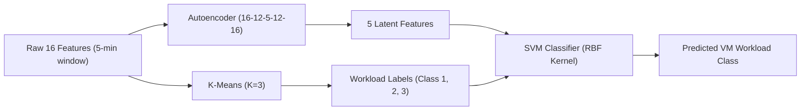

# Reference Paper Comprehensive Analysis

**Reference Article:**  
Alelyani, A., Datta, A., and Hassan, G. M. (2026). *A machine learning technique for optimizing virtual machine placement in data-centres.* **Journal of Cloud Computing**, 15:37. [https://doi.org/10.1186/s13677-026-00851-3](https://doi.org/10.1186/s13677-026-00851-3)

**Document:** `docs/reference_paper_analysis.md`  
**Role:** Desk Research & Methodological Foundation for the Proposed Extension  

---

## 1. Research Problem and Motivation

High demand for cloud services has dramatically driven up data centre energy consumption, which grew from 194 TWh to 205 TWh between 2010 and 2018 and is projected to reach 8,000 TWh by 2030. In typical enterprise data centres, physical machines (PMs) often operate at low average utilization (often around 30–50%), leading to massive energy waste because even idle or lightly loaded PMs consume substantial baseline power (often 50–70% of peak power).

While virtual machine (VM) consolidation and live migration (LVM) are widely employed to pack workloads onto fewer PMs, existing approaches suffer from major shortcomings:
1. **Single-Resource Bias:** Most algorithms optimize placement solely around CPU load (or occasionally memory in isolation), overlooking the multi-resource dynamics of modern workloads.
2. **Ignorance of VM Workload Types:** VMs exhibit distinct behavioral profiles (CPU-intensive, memory-intensive, balanced). Aggressively co-locating multiple CPU-intensive VMs on the same host triggers severe CPU contention, high queuing latency, and Service Level Agreement violations (SLAv). Co-locating multiple memory-intensive VMs induces memory pressure, thrashing, and prolonged migration downtimes.
3. **Reactive vs. Predictive Decisions:** Traditional heuristic consolidation acts only after hosts become overloaded or underloaded, causing late migrations and service degradation during surges.

---

## 2. Key Contributions of the Reference Paper

1. **Least-Loaded Initial Allocation:** Incoming VMs are initially deployed to the least-loaded PM based on both CPU and memory to allow a short observation window (5 minutes) while reducing immediate placement contention and accommodating short batch jobs.
2. **Latent Feature Extraction & Classification Model:** Arriving VMs are observed for 5 minutes. An Autoencoder extracts a 5-dimensional latent representation from 16 resource metrics, and a Support Vector Machine (SVM) classifies VMs into three distinct resource profiles.
3. **Type-Aware Heterogeneous Consolidation:** Migrations consolidate VMs into fewer PMs while enforcing a strict diversity constraint: no PM is allowed to exceed 25% CPU-intensive (Type 2) VMs.
4. **Substantial Reported Reductions:** Evaluated on a subset of the Google Cluster Data trace, the authors report:
   - 40% mean energy reduction compared to benchmark algorithms.
   - 51% energy reduction compared to the Google production scheduler (40,143 wph vs. 83,314 wph).
   - 62.43% average resource utilization compared to 31.2% in Google's trace.
   - 63.3% reduction in active hosts (from 798 to 293 PMs).
   - Near-zero SLA violations under the evaluated scenario.

---

## 3. Dataset Description and Experimental Subsets

The study utilizes the **Google Cluster Workload Trace 2019** covering one month of cluster operations:
- Tables examined: `machine_events`, `machine_attributes`, `collection_events`, `instance_events`, `instance_usage`.
- Trace units: CPU measured in CPU-core seconds per second (normalized to Google Compute Units, GCUs); memory measured in normalized fractions of host memory.
- Google instance sizing in the trace: Micro (0.25 GCU), Small (0.50 GCU), Medium (1.0 GCU).

The authors constructed two experimental subsets:
1. **ML Training & Classification Subset:**
   - **2,293 VM instances** representing over 40% of the selected activity subset.
   - Each VM was observed during its first **5 minutes** of execution.
   - Split: **70% Training**, **10% Validation**, **20% Testing**.
2. **Scheduling Evaluation Subset:**
   - **7,644 VMs** and **798 PMs** simulated across a 24-hour trace window.

---

## 4. Feature Engineering Methodology (The 16 Extracted Features)

Alelyani et al. derived **16 distinct features** from the first 5 minutes of each VM's `instance_usage` time series:
1. **CPU Utilization Metrics (4 features):**
   - Maximum CPU utilization
   - Minimum CPU utilization
   - Average CPU utilization
   - CPU usage distribution (percentiles capturing variance and peak burstiness)
2. **Instruction-Level Efficiency (2 features):**
   - Cycles Per Instruction (CPI)
   - Memory Accesses Per Instruction (MAI)
3. **Memory Utilization Metrics (5 features):**
   - Maximum memory utilization
   - Minimum memory utilization
   - Average memory utilization
   - Assigned memory
   - Page cache memory
4. **Temporal Lifecycle Features (3 features):**
   - Start time ($t_{\text{start}}$)
   - End time ($t_{\text{end}}$)
   - Duration / time window ($\Delta t$)
5. **Auxiliary / Derived Ratios (2 features):**
   - Peak-to-average CPU ratio and memory-to-CPU proportionality ratio.

*Crucial Audit Confirmation:* As verified in our Phase 1 data audit, Google Cluster Data 2019 does **not** contain network or disk I/O metrics in `instance_usage`. Alelyani et al. specifically utilized this 16-feature set because it accurately mirrors the actual available telemetry in the 2019 schema.

---

## 5. Machine Learning Architecture in the Reference Study

The ML pipeline operates in three consecutive steps:

1. **Unsupervised Workload Labeling:** K-Means ($K=3$) generates cluster labels based on resource utilization and duration:
   - **Class 1 (926 VMs):** Low CPU usage (mean: 0.028 GCU, max memory: 0.05).
   - **Class 2 (407 VMs):** Highly CPU-intensive (mean: 0.17 GCU — 10x higher than Class 1, negligible memory).
   - **Class 3 (922 VMs):** Balanced / Moderate CPU (mean: 0.0542 GCU, memory: 0.0089 for 90% of instances).
2. **Dimensionality Reduction via Autoencoder:**
   - Architecture: Fully connected symmetric encoder-decoder: `16 -> 12 -> 5 -> 12 -> 16`.
   - Activation: ReLU on hidden layers, Sigmoid on output layer.
   - Training: Adam optimizer, MSE loss, 500 epochs, batch size 64. Reported reconstruction accuracy > 98%.
3. **Classification via Support Vector Machine (SVM):**
   - Radial Basis Function (RBF) kernel with grid-search cross-validation for hyperparameters $C$ and $\gamma$.
   - Input: 5 latent features from the encoder bottleneck.
   - Classification Performance:
     * Precision: Class 1 = 0.71, Class 2 = 0.78, Class 3 = 0.78 (Macro Avg: 0.79).
     * Sensitivity / Recall: Class 1 = 0.76, Class 2 = 0.94, Class 3 = 0.70 (Macro Avg: 0.80).
     * F1-score: Class 1 = 0.73, Class 2 = 0.91, Class 3 = 0.74 (Weighted Avg: 0.77).
     * Overall Accuracy: 76.9%.

---

## 6. Scheduling and Migration Algorithms

The reference framework operates in two distinct phases:

### Phase 1: Preliminary Scheduling (Algorithm 1)
- Maintains PMs in a sorted list $L_c = \{pm_1, pm_2, \dots, pm_n\}$ in ascending order of combined utilization.
- Incoming jobs $j \in Q$ sorted by Priority Metric:
  $$\text{Priority}_{\text{initial}} = \text{sort}(VMs, \{A_i, -P_i, R_i\})$$
  where $A_i$ is arrival time (ascending), $P_i$ is execution priority (descending, 0–300), and $R_i$ is resource requirement.
- Greedily assigns VM to the least-loaded PM that satisfies resource constraints and does not exceed the upper utilization threshold $T_h = 75\%$.
- The VM executes for 5 minutes on this host to record its telemetry.

### Phase 2: Consolidation and Migration (Algorithm 2)
- Evaluates active PMs against static thresholds:
  - Upper threshold: $T_h = 75\%$
  - Lower threshold: $T_l = 35\%$
- Partitions PMs into overloaded list $L_{m1}$ ($Load(p) > T_h$) and underloaded list $L_{m2}$ ($Load(p) < T_l$).
- Migrates VMs from $L_{m2}$ into $L_{m1}$ using an all-or-nothing policy: if all VMs on an underloaded host cannot be migrated, none are migrated.
- **Type-2 CPU-Intensive Invariant:** A strict constraint prevents any target host from having more than **25%** of its CPU capacity utilized by Class 2 VMs:
  $$\text{AvgJob2}(p) \le 25\%$$
  If an active host exceeds this threshold at any time, a migration is triggered to redistribute CPU-intensive VMs to less-loaded PMs.

---

## 7. Energy and SLA Models

### 7.1 Server Energy Model (SPECpower Benchmark)
- Host hardware assumed: **HP ProLiant G5** servers.
-SPECpower benchmark power profile for HP G5:
  * Sleep: 10 W
  * 0% (Idle): 93.7 W
  * 10%: 97.0 W
  * 20%: 101.0 W
  * 30%: 105.0 W
  * 40%: 110.0 W
  * 50%: 116.0 W
  * 60%: 121.0 W
  * 70%: 125.0 W
  * 80%: 129.2 W (interpolated)
  * 90%: 133.0 W
  * 100% (Peak): 135.0 W
- Energy model formulation:
  $$P(u) = P_{\text{idle}} + (P_{\text{max}} - P_{\text{idle}}) \cdot u^k$$
  with $u \in [0, 1]$ and non-linearity coefficient $k \in [1, 2]$ calibrated to the SPECpower curve.
- Total energy over interval $[t_0, t_1]$:
  $$E = \int_{t_0}^{t_1} P(u(t)) \, dt$$

### 7.2 Service Level Agreement Violation (SLAv) Model
Adopts the dual-metric formulation from Beloglazov & Buyya (2012):
1. **SLA Violation Time per Active Host (SLATAH):**
   $$\text{SLATAH} = \frac{1}{N} \sum_{i=1}^N \frac{T_i^{\text{un}}}{T_{ai}}$$
   where $T_i^{\text{un}}$ is the duration PM $i$ operated at 100% CPU utilization, and $T_{ai}$ is active duration.
2. **Performance Degradation due to Migrations (PDM):**
   $$\text{PDM} = \frac{1}{M} \sum_{j=1}^M \frac{C_j^{\text{dm}}}{C_j^{\text{rm}}}$$
   where $C_j^{\text{rm}}$ is total lifetime CPU required, and $C_j^{\text{dm}}$ is estimated migration degradation:
   $$C_j^{\text{dm}} = 0.1 \times \int_{t_{\text{start}}}^{t_{\text{start}} + T} U_{\text{cpu}} \, dt, \quad T = \frac{\text{VM}_{\text{memory}}}{B_w}$$
   with network bandwidth $B_w = 4\text{ Gbps}$.
3. **Combined SLAv Metric:**
   $$\text{SLAv} = \text{SLATAH} \times \text{PDM}$$

---

## 8. Benchmark Baselines and Reported Results

### 8.1 Evaluated Baselines
1. **Modified First Fit (MFFA):** Assigns VM to first feasible PM respecting $T_h \le 75\%$.
2. **Modified Best Fit (MBFA):** Assigns VM to feasible PM with tightest remaining capacity below $T_h \le 75\%$.
3. **Sercon:** Greedy consolidation migrating VMs from least-loaded to most-loaded PMs; all-or-nothing lower threshold.
4. **Round Robin (RR):** Cyclic allocation similar to standard Google scheduler with $T_h \le 75\%$.
5. **Google Scheduler (Production Trace):** Empirical workload placement directly extracted from the trace.

### 8.2 Summary of Reported Experimental Results (Alelyani et al. Table 6)

| Metric | Google Scheduler | MBFA | MFFA | Sercon | Alelyani et al. Proposed |
| :--- | :---: | :---: | :---: | :---: | :---: |
| **Average Resource Utilization (AUR)** | 32.0% | 50.66% | 51.89% | 31.22% | **62.43%** |
| **Active PMs** | 798 | 567 | 588 | 771 | **293** (-63.3%) |
| **Idle / Sleep PMs** | 0 | 231 | 210 | 27 | **505** |
| **Total Energy (TEC, wph)** | 83,313.9 | 67,351.0 | 69,335.7 | 80,740.0 | **40,143.0** (-51.8%) |
| **Migrated VMs** | 0 | 0 | 0 | 498 | **3** |
| **Migration Cost** | 0 | 0 | 0 | 0.0053 | **0.000032** |
| **Overloaded PMs** | 61 | 0 | 0 | 60 | **0** |
| **Underloaded PMs** | 549 | 32 | 35 | 477 | **2** |
| **SLATAH** | 0.0027 | 0 | 0 | 0.0021 | **0** |
| **SLAv Detected?** | Yes | No | No | Yes | **No** |

---

## 9. Key Limitations of the Reference Study

1. **Short Observation Window & Static Prediction:**
   - The paper only observes VMs for the first 5 minutes to classify them into static categories.
   - It assumes that a VM's workload profile remains constant over its entire multi-hour/multi-day lifetime. Real cloud tasks exhibit substantial temporal non-stationarity, phase changes, and diurnal cycles.
2. **Uncalibrated Clustering Parameter ($K=3$ fixed):**
   - The authors set $K=3$ a priori without evaluating clustering metrics (Silhouette, Davies–Bouldin, Calinski–Harabasz).
3. **Greedy Heuristic Placement:**
   - Placement relies on sorting PMs by utilization rather than global combinatorial optimization.
   - It cannot escape local optima or balance multi-dimensional trade-offs simultaneously.
4. **Static Host Thresholds:**
   - Fixed 75% upper and 35% lower thresholds are arbitrary and non-adaptive.
5. **No Migration Cost-Benefit Model:**
   - Migrations do not weigh the energy saved after migration against the energy consumed during the live transfer.

---

## 10. How Our Proposed Architecture Extends and Improves the Reference Paper

| Component | Alelyani et al. (2026) Reference Paper | Our Proposed Research Architecture |
| :--- | :--- | :--- |
| **Workload Modeling** | Static 5-minute scalar summary statistics | Multi-step temporal sequence histories |
| **Prediction Engine** | Autoencoder latent bottleneck + SVM classifier | **Multivariate Long Short-Term Memory (LSTM)** neural network forecasting resource demand at 10, 30, and 60 minutes |
| **Clustering & Profiling** | K-Means with fixed $K=3$, no cluster validation | **K-Means++** systematically evaluated across $K \in \{3, 4, 5, 6\}$ using Silhouette, Davies–Bouldin, and Calinski–Harabasz indices |
| **Host Thresholds** | Static thresholds ($T_h=75\%, T_l=35\%$) | **Dynamic, predicted-load-aware PM thresholds** adapting to anticipated future congestion |
| **Placement Engine** | Greedy least-loaded heuristic sorting | **Ant Colony Optimization (ACO)** multi-objective metaheuristic searching global Pareto trade-offs |
| **Migration Policy** | MMT heuristic and 25% Class-2 rule | **Explicit Energy-Cost-Benefit Model**: Migrates only when $\Delta E_{\text{saved}} - E_{\text{mig}} - \text{SLA}_{\text{penalty}} > \tau$ |
| **Evaluation Scope** | Basic heuristic comparisons (MFFA, MBFA, Sercon, RR) | Comprehensive baselines + exhaustive **ablation studies** (LSTM vs. Persistence, ACO vs. Greedy, Static vs. Dynamic thresholds, Linear vs. Nonlinear power) |

---
*End of docs/reference_paper_analysis.md*

