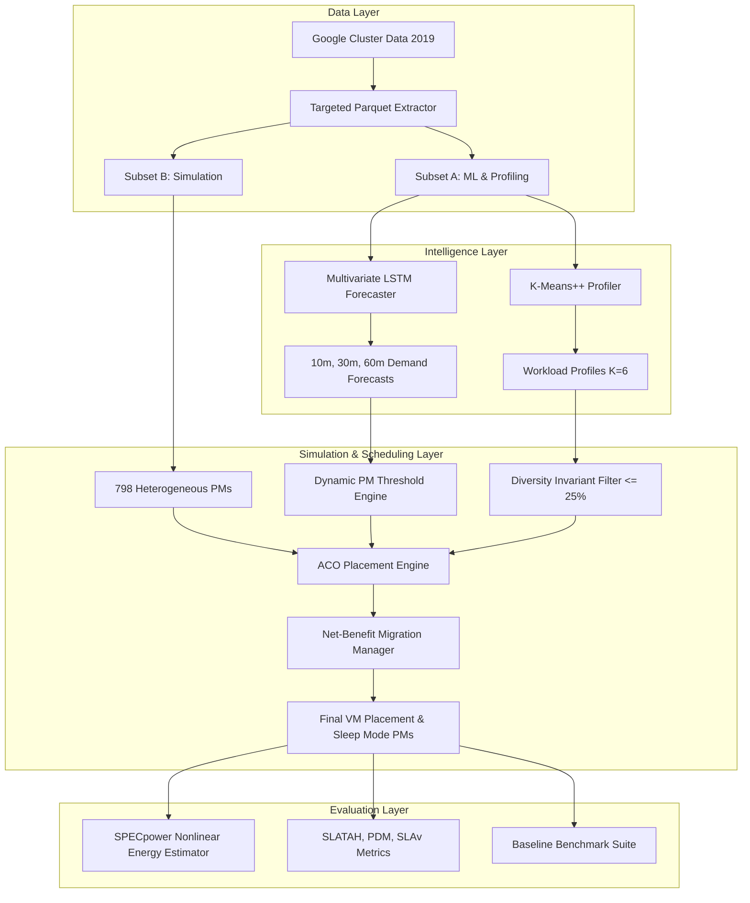

# System Architecture Specification

## 1. Modular Architecture Overview

## 2. Package Structure
- `src/vm_scheduler/data/`: Manifest querying, schema inspection, and targeted extraction.
- `src/vm_scheduler/preprocessing/`: Normalization, chronological splitting, sliding-window generation.
- `src/vm_scheduler/features/`: Feature extraction, variance filtering, and collinearity pruning.
- `src/vm_scheduler/prediction/`: PyTorch LSTM model, trainer, persistence/moving average baselines, regression metrics.
- `src/vm_scheduler/clustering/`: K-Means++ evaluation suite across $K \in \{3,4,5,6\}$ and cluster profiler.
- `src/vm_scheduler/simulation/`: Heterogeneous physical machines (HP G5/G4), virtual machines, and capacity constraints.
- `src/vm_scheduler/scheduling/`: ACO multi-objective placement, dynamic thresholds, and net-benefit live migration engine.
- `src/vm_scheduler/energy/`: SPECpower nonlinear energy model ($P(u) = P_{\text{idle}} + (P_{\text{max}} - P_{\text{idle}}) u^{1.4}$) and sleep power integration.
- `src/vm_scheduler/baselines/`: Modified First Fit (MFFA), Modified Best Fit (MBFA), Sercon, Round Robin (RRA).
- `src/vm_scheduler/evaluation/`: Standard research metric calculators matching Alelyani et al. Table 6.
- `src/vm_scheduler/utils/`: Deterministic seed setting, logging, and YAML configuration loading.

