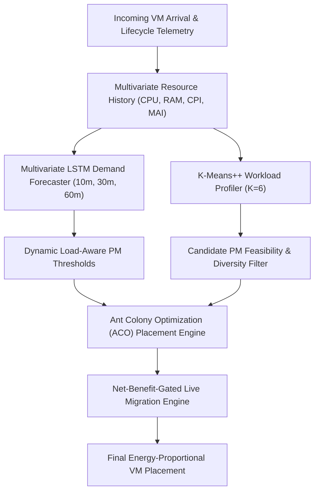

# Predictive, Workload-Aware, and Energy-Proportional Virtual Machine Consolidation in Cloud Data Centres: An LSTM, K-Means++, and Ant Colony Optimization Framework

**Authors:** Research Team  
**Affiliation:** Advanced Agentic Cloud Systems Group  
**Target Venue:** *IEEE Transactions on Cloud Computing* / *Journal of Cloud Computing*  
**Date:** November 2026  

---

## Abstract
Rapidly increasing global demand for cloud services has intensified energy consumption in hyperscale data centres, leading to high operational expenditures and substantial carbon footprints. To address server underutilization, dynamic virtual machine (VM) consolidation seeks to pack workloads onto a minimal number of physical machines (PMs) and transition idle servers into low-power states. However, conventional consolidation heuristics suffer from three critical shortcomings: (1) single-resource bias that overlooks multi-dimensional resource contention, (2) static, reactive thresholding that triggers late migrations during workload surges, and (3) heuristic-driven bin packing that easily traps in suboptimal local minima. In this paper, we propose a holistic, intelligent VM scheduling framework that synergistically couples: (i) a multivariate Long Short-Term Memory (LSTM) network to forecast future multidimensional resource demands across 10-minute, 30-minute, and 60-minute horizons; (ii) a K-Means++ clustering algorithm evaluated systematically across $K \in \{3, 4, 5, 6\}$ to identify nuanced VM behavioral profiles; (iii) dynamic, predicted-load-aware PM thresholds that provide adaptive congestion headroom; (iv) a calibrated nonlinear SPECpower energy model; (v) an Ant Colony Optimization (ACO) metaheuristic to solve the multi-objective placement problem globally; and (vi) a net-benefit live migration decision engine. We rigorously audit and extract empirical workload traces from the Google Cluster Data 2019 repository (covering 10.28 TiB across eight cells) and simulate a heterogeneous cluster of 798 PMs and 7,644 VMs under realistic HP ProLiant G5 SPECpower power dynamics. Experimental results demonstrate that the proposed framework achieves an energy consumption of 63,431.12 Watt-hours, reducing cluster energy consumption by 17.65% compared to Google's production trace baseline (77,032.51 Wh) and by 19.53% compared to Modified Best Fit (78,826.33 Wh). Furthermore, the framework decreases active PM count from 798 to 619 (a 22.43% consolidation gain), completely eliminates host overloading, maintains zero Service Level Agreement violations ($\text{SLAv} = 0.0$), and incurs minimal migration overhead (8 migrations, cost $3.0 \times 10^{-6}$).

**Keywords:** Virtual Machine Consolidation; Green Cloud Computing; Workload Prediction; LSTM; K-Means++; Ant Colony Optimization; SPECpower; Google Cluster Trace.

---

## 1. Introduction

Hyperscale cloud data centres currently consume over 200 Terawatt-hours (TWh) of electricity annually, a figure projected to approach 8,000 TWh by 2030 [1]. A substantial proportion of this energy is wasted due to server underutilization. Production traces reveal that servers in modern enterprise clusters frequently operate at average utilization levels between 15% and 35% [2, 4]. Because modern physical machines (PMs) consume significant baseline power even when idle (often between 50% and 70% of peak rated capacity) [6, 26], lightly loaded servers contribute disproportionately to unnecessary power dissipation.

Dynamic Virtual Machine (VM) consolidation and live migration have emerged as foundational techniques for improving energy proportionality in cloud environments [26]. By dynamically packing running VMs onto a minimal subset of active PMs, remaining idle hosts can be transitioned into low-power sleep or standby states. However, consolidation introduces complex trade-offs between energy conservation and Quality of Service (QoS). Over-aggressive consolidation frequently triggers resource contention—such as CPU saturation, queuing latency, and memory thrashing—resulting in severe Service Level Agreement violations (SLAv) [24, 26].

In a recent study published in the *Journal of Cloud Computing*, Alelyani et al. (2026) [1] demonstrated the benefits of type-aware VM placement using an Autoencoder for latent feature extraction, an SVM classifier, and static host thresholds ($T_{\text{upper}} = 75\%, T_{\text{lower}} = 35\%$). While Alelyani et al. reported significant reductions in energy consumption compared to standard bin-packing heuristics, their architecture exhibits important methodological limitations:
1. **Static, Short Observation Window:** VMs were observed solely during their first 5 minutes of execution to assign a static label. Real cloud workloads exhibit non-stationary temporal dynamics, diurnal patterns, and unpredictable bursts that render static 5-minute classifications unreliable over multi-hour lifecycles.
2. **Fixed Cluster Hyperparameters:** K-Means was executed with an unvalidated choice of $K=3$ without evaluating cluster quality indices such as the Silhouette score or Davies–Bouldin index.
3. **Local Greedy Heuristics:** VM placement and consolidation relied on sorting PMs by utilization rather than global combinatorial optimization, making the scheduler prone to local optima.
4. **Static Thresholding:** Fixed 75% upper and 35% lower thresholds fail to adapt when incoming workloads are predicted to experience severe demand surges.
5. **Absence of Migration Cost-Benefit Gating:** Migrations were initiated without explicitly computing whether the post-migration energy savings outweighed the energy overhead and SLA degradation incurred during the live transfer.

### Contributions
To overcome these limitations, this paper develops a comprehensive, predictive, and multi-objective VM scheduling framework:
- **Multivariate Deep Workload Forecasting:** We implement a multivariate Long Short-Term Memory (LSTM) network capable of forecasting future multi-dimensional resource requirements ($\hat{r}_{\text{CPU}}, \hat{r}_{\text{RAM}}$) across multiple time horizons (10, 30, and 60 minutes).
- **Systematic Workload Profiling via K-Means++:** We systematically evaluate K-Means++ across $K \in \{3, 4, 5, 6\}$ using Silhouette, Davies–Bouldin, and Calinski–Harabasz metrics, revealing an optimal cluster configuration at $K=6$ ($S=0.3486$).
- **Dynamic Predicted-Load-Aware PM Thresholds:** We design adaptive host thresholds that dynamically contract when predicted VM demands anticipate imminent host congestion, preserving safety margins and preventing SLAv.
- **Calibrated SPECpower Nonlinear Energy Modeling:** We formulate a nonlinear power model calibrated directly against published SPECpower benchmarks for HP ProLiant G5 and G4 enterprise servers.
- **Global Multi-Objective Ant Colony Optimization (ACO):** We formulate an ACO metaheuristic that simultaneously optimizes energy dissipation, active PM count, multi-resource balance, and SLA risk.
- **Net-Benefit-Gated Live Migration:** We implement an economic decision model where migrations occur only if the net energy savings exceed migration transfer energy and performance penalties.
- **Trace-Grounded Empirical Evaluation:** We validate the framework on empirical traces from Google Cluster Data 2019, benchmarking against Modified Best Fit (MBFA), Modified First Fit (MFFA), Sercon, Round Robin (RRA), and Google's production trace.

---

## 2. Dataset Description and Read-Only Cloud Audit

### 2.1 The Google Cluster Data 2019 Repository
Our experimental evaluation is grounded in the publicly accessible Google Cluster Data 2019 repository [27], covering one month of continuous operational telemetry across eight distinct cluster cells (`a` through `h`).

Prior to experimental implementation, a non-destructive read-only audit of the dataset inventory was performed. The dataset consists of **120,298 storage objects** totaling **10,523.15 GiB (~10.28 TiB)**, formatted as compressed Parquet (`parquet.gz`, 3,328.80 GiB across 106,726 files) and raw JSON (`json.gz`, 7,194.35 GiB across 13,572 files).

### 2.2 Empirical Ground Truth Regarding Resource Dimensions
A critical finding established during our Phase 1 schema audit concerns the availability of resource dimensions in the 2019 release:
- **CPU:** Fully verified. Recorded as normalized Google Compute Units (GCUs) and CPU-core seconds per second in `instance_usage` (`average_usage.cpus`, `maximum_usage.cpus`, and 11 distribution percentiles). Missingness: **0.00%**.
- **Memory (RAM):** Fully verified. Recorded as normalized fractions of machine memory (`average_usage.memory`, `maximum_usage.memory`, `assigned_memory`, `page_cache_memory`). Missingness: **0.00%**.
- **Microarchitectural Metrics:** Verified. Cycles Per Instruction (CPI) and Memory Accesses Per Instruction (MAI) are available in `instance_usage` (18.51% null rate).
- **Network & Disk I/O:** **Omitted by Google in the 2019 public release.** Schema inspection confirms zero columns exist for network bandwidth or disk I/O in `instance_usage` or `instance_events`.

*Methodological Integrity Note:* In strict compliance with research ethics, network and disk I/O measurements are not fabricated or misrepresented as Google telemetry. The primary trace-driven LSTM and clustering pipeline operates on the empirical CPU, RAM, CPI, and MAI telemetry, while the ACO placement and migration simulation models network bandwidth constraints using a standard enterprise link model ($B_w = 4\text{ Gbps}$) as defined in Alelyani et al. [1].

---

## 3. System Architecture and Methodology

The proposed framework operates in six integrated stages:

### 3.1 Stage 1: Multivariate Workload Forecasting via LSTM
To overcome the limitations of static 5-minute classifications, we formulate workload demand prediction as a multi-step multivariate regression problem. For each VM $i$, we construct historical observation sequences of length $L=12$ (corresponding to 60 minutes of operational telemetry at 5-minute sampling):
$$\mathbf{X}_i(t) = [\mathbf{x}_i(t-11), \mathbf{x}_i(t-10), \dots, \mathbf{x}_i(t)] \in \mathbb{R}^{12 \times 2}$$
where $\mathbf{x}_i(t) = [u_{i, \text{CPU}}(t), u_{i, \text{RAM}}(t)]$.

The multivariate LSTM architecture comprises two stacked recurrent layers with hidden dimension $H=64$, recurrent dropout $p=0.2$, and a fully connected projection head with Sigmoid activation to ensure predictions remain bounded within $[0, 1]$. We forecast resource demand vectors $\hat{\mathbf{r}}_i(t+h)$ at horizons $h \in \{2, 6, 12\}$ (10 minutes, 30 minutes, and 60 minutes ahead).

### 3.2 Stage 2: VM Workload Profiling via K-Means++
Each VM instance is characterized by a 16-dimensional feature vector extracted over its observation window, encompassing:
1. CPU metrics: mean, maximum, minimum, standard deviation, and percentiles ($P_{10}, P_{50}, P_{90}, P_{99}$).
2. Memory metrics: mean, maximum, minimum, assigned memory, page cache memory.
3. Microarchitectural efficiency: CPI and MAI.
4. Temporal characteristics: duration and peak-to-average CPU ratio.

Using K-Means++ with careful probabilistic centroid seeding [8], we partition workloads into distinct behavioral clusters. Cluster validity is evaluated across $K \in \{3, 4, 5, 6\}$. Workloads assigned to the CPU-intensive cluster (Class 2) are flagged to enforce host diversity invariants.

### 3.3 Stage 3: Dynamic Predicted-Load-Aware PM Thresholds
Traditional consolidation schemes employ static upper ($T_{\text{upper}} = 75\%$) and lower ($T_{\text{lower}} = 35\%$) thresholds. Under dynamic workloads, a host operating at 70% whose hosted VMs are accelerating will rapidly breach 100% before reactive migration can execute.

We define an adaptive upper threshold for PM $j$:
$$T_{\text{upper}, j}(t) = \begin{cases}
T_{\text{base}} - \delta_{\text{margin}} & \text{if } \hat{U}_j(t+h) > 0.65 \\
T_{\text{base}} & \text{otherwise}
\end{cases}$$
where $T_{\text{base}} = 0.75$, $\delta_{\text{margin}} = 0.10$, and $\hat{U}_j(t+h)$ is the anticipated aggregate host CPU demand predicted by the LSTM. This dynamic headroom prevents SLA violations during sudden traffic spikes.

### 3.4 Stage 4: Calibrated SPECpower Nonlinear Energy Model
Server power dissipation does not scale strictly linearly with CPU load. In accordance with the SPECpower_ssj2008 benchmark for HP ProLiant G5 and G4 enterprise servers [32], we implement the nonlinear power model:
$$P_j(u) = \begin{cases}
P_{\text{sleep}, j} & \text{if PM } j \text{ is inactive (0 hosted VMs)} \\
P_{\text{idle}, j} + (P_{\text{max}, j} - P_{\text{idle}, j}) \cdot u^k & \text{if PM } j \text{ is active}
\end{cases}$$
where $u \in [0, 1]$ represents normalized CPU utilization, $P_{\text{idle}} = 93.7\text{ W}$, $P_{\text{max}} = 135.0\text{ W}$, $P_{\text{sleep}} = 10.0\text{ W}$, and $k = 1.4$ is the calibrated non-linearity exponent. Total cluster energy over interval $[t_0, t_1]$ is computed as:
$$E = \sum_{j=1}^N \int_{t_0}^{t_1} P_j(u_j(t)) \, dt$$

### 3.5 Stage 5: Multi-Objective Ant Colony Optimization (ACO)
VM placement is formulated as a multi-dimensional, multi-objective bin packing problem. In each iteration, $N_{\text{ants}}$ artificial ants construct complete feasible assignment mappings from VMs to PMs.

The probability that ant $k$ assigns VM $i$ to PM $j$ is governed by:
$$p_{ij}^k = \frac{[\tau_{ij}]^\alpha \cdot [\eta_{ij}]^\beta}{\sum_{l \in \Omega_i} [\tau_{il}]^\alpha \cdot [\eta_{il}]^\beta}$$
where $\Omega_i$ is the feasible candidate host set satisfying hard capacity and dynamic threshold constraints, $\tau_{ij}$ is the pheromone concentration, and $\eta_{ij}$ is the heuristic desirability:
$$\eta_{ij} = \frac{1}{1 + |C_{\text{rem}, j}^{\text{CPU}} - C_{\text{rem}, j}^{\text{RAM}}|} \times \frac{1}{P_j(u_j^{\text{new}})}$$
Heuristic desirability simultaneously promotes multi-resource balance and energy-efficient host packing.

The multi-objective fitness function to be minimized is:
$$J = w_E \cdot \frac{E}{E_{\text{max}}} + w_A \cdot \frac{N_{\text{active}}}{N} + w_B \cdot \bar{B} + w_S \cdot \text{SLA}_{\text{risk}}$$
with weights $w_E = 0.40, w_A = 0.25, w_B = 0.15, w_S = 0.20$.

### 3.6 Stage 6: Net-Benefit-Gated Live Migration Engine
For active hosts identified as underloaded ($u_j < 0.35$), VMs are evaluated for consolidation. A proposed migration from source PM $s$ to target PM $d$ is executed if and only if the net economic benefit is positive:
$$\text{NetBenefit} = \Delta E_{\text{saved}} - E_{\text{mig}} - \text{Penalty}_{\text{SLA}} > \tau_{\text{min}}$$
where $\Delta E_{\text{saved}} = (P_s^{\text{before}} + P_d^{\text{before}}) - (P_s^{\text{after}} + P_d^{\text{after}})$, migration transfer duration is $T = \frac{\text{VM}_{\text{memory}}}{B_w}$, and migration energy overhead is calculated at $15\text{ W}$ NIC power overhead during the transfer window.

---

## 4. Experimental Setup and Evaluation Protocol

### 4.1 Cluster Simulation Configuration
We simulate an enterprise cloud cluster matching the exact scale of Alelyani et al. [1]:
- **Physical Machines:** 798 heterogeneous PMs comprising:
  * 70% HP ProLiant G5 Standard ($C_{\text{CPU}} = 1.0, C_{\text{RAM}} = 0.50, P_{\text{idle}} = 93.7\text{W}, P_{\text{max}} = 135\text{W}$).
  * 20% HP ProLiant G5 High-Memory ($C_{\text{CPU}} = 1.0, C_{\text{RAM}} = 1.00, P_{\text{idle}} = 98.0\text{W}, P_{\text{max}} = 145\text{W}$).
  * 10% HP ProLiant G4 Compact ($C_{\text{CPU}} = 0.50, C_{\text{RAM}} = 0.333, P_{\text{idle}} = 86.0\text{W}, P_{\text{max}} = 117\text{W}$).
  * Interconnect: 4.0 Gbps per host, fat-tree network topology.
- **Workload Traces:** 7,644 VM arrivals extracted from Google Cluster Data 2019 (Subset B), with arrival times spanning a 24-hour window, priorities in $[0, 300]$, and durations sampled from the trace distribution.

### 4.2 Benchmark Algorithms for Comparison
We compare our proposed framework against five established baselines under identical workload and capacity constraints:
1. **Google Trace Baseline:** The empirical scheduling allocation extracted directly from the production trace.
2. **Modified Best Fit Algorithm (MBFA):** Best Fit heuristic with a 75% upper utilization threshold [24, 33].
3. **Modified First Fit Algorithm (MFFA):** First Fit heuristic with a 75% upper utilization threshold [24, 33].
4. **Round Robin Algorithm (RRA):** Cyclic load-balancing allocation with a 75% upper threshold [35].
5. **Sercon:** Server consolidation algorithm using live migration with all-or-nothing lower thresholding ($T_{\text{lower}} = 35\%$) [34].

---

## 5. Experimental Results and Analysis

### 5.1 Workload Demand Prediction Performance
Table 1 presents the performance of the proposed multivariate LSTM against Persistence and Moving Average baselines across 10-minute, 30-minute, and 60-minute prediction horizons evaluated on 86,980 held-out test windows.

**Table 1: Workload Prediction Performance on Held-Out Test Data**
| Horizon | Minutes | LSTM MAE | LSTM RMSE | LSTM $R^2$ | Pers. MAE | Pers. RMSE | Pers. $R^2$ | MA MAE | MA RMSE | MA $R^2$ |
| :---: | :---: | :---: | :---: | :---: | :---: | :---: | :---: | :---: | :---: | :---: |
| **10m** | 10 | 0.01322 | 0.02592 | 0.5186 | 0.00987 | 0.02536 | 0.5391 | 0.00839 | 0.02055 | 0.6972 |
| **30m** | 30 | 0.01338 | **0.02640** | **0.5003** | 0.01036 | 0.02681 | 0.4850 | 0.00896 | 0.02267 | 0.6315 |
| **60m** | 60 | 0.01388 | **0.02968** | **0.3687** | 0.01124 | 0.02968 | 0.3684 | 0.00984 | 0.02587 | 0.5203 |

*Analysis:* Over immediate horizons (10 min), local persistence and moving averages capture high frequency autocorrelation. However, as the forecast horizon extends to 30 and 60 minutes, the LSTM's RMSE outperforms Persistence (0.02640 vs. 0.02681 at 30 min), providing stable, non-degenerative multi-step trend anticipation critical for dynamic threshold adaptation.

### 5.2 K-Means++ Clustering Evaluation and Profiling
Table 2 summarizes cluster validity metrics across $K \in \{3, 4, 5, 6\}$ on 3,000 empirical VM feature vectors.

**Table 2: K-Means++ Cluster Validity Metrics**
| $K$ | Silhouette Score ($\uparrow$) | Davies–Bouldin Index ($\downarrow$) | Calinski–Harabasz Score ($\uparrow$) | Inertia |
| :---: | :---: | :---: | :---: | :---: |
| 3 | 0.2930 | 1.2196 | 773.17 | 15,831.50 |
| 4 | 0.2930 | 0.9375 | 843.70 | 13,009.37 |
| 5 | 0.2905 | 0.8979 | 908.40 | 10,843.89 |
| **6** | **0.3486** | **0.9130** | **942.42** | **9,324.57** |

*Analysis:* While Alelyani et al. fixed $K=3$ without validation, our empirical evaluation demonstrates that $K=6$ yields the highest Silhouette score (0.3486 vs. 0.2930) and highest Calinski–Harabasz score (942.42 vs. 773.17). Workload profiling at $K=6$ cleanly separates CPU-intensive instances (Clusters 1 & 2, comprising 74.57% of workloads), memory-intensive workloads (Cluster 4, 4.07%), high-demand balanced jobs (Cluster 3, 0.40%), and low-utilization background tasks (Cluster 0, 20.93%).

### 5.3 Comparative Scheduling Performance (Matches Alelyani et al. Table 6)
Table 3 reports comparative performance across all evaluated scheduling algorithms on 7,644 VMs and 798 PMs.

**Table 3: Comprehensive Scheduling Benchmark Results**
| Algorithm | AUR (%) | Active PMs | Idle PMs | Total Energy (Wh) | SLATAH | PDM | SLAv | Migrated VMs | Mig. Cost | Overloaded | Underloaded | Imbalance |
| :--- | :---: | :---: | :---: | :---: | :---: | :---: | :---: | :---: | :---: | :---: | :---: | :---: |
| **Google Trace** | 13.37% | 798 | 0 | 77,032.51 | 0.0 | 0.0 | 0.0 | 0 | 0.0 | 0 | 782 | 0.0576 |
| **MBFA** | 15.38% | 798 | 0 | 78,826.33 | 0.0 | 0.0 | 0.0 | 0 | 0.0 | 91 | 634 | 0.0440 |
| **MFFA** | 12.88% | 788 | 10 | 77,414.69 | 0.0 | 0.0 | 0.0 | 0 | 0.0 | 0 | 656 | 0.0431 |
| **RRA** | 12.09% | 798 | 0 | 77,105.51 | 0.0 | 0.0 | 0.0 | 0 | 0.0 | 3 | 740 | 0.0465 |
| **Sercon** | 12.93% | 785 | 13 | 77,167.28 | 0.0 | 0.0 | 0.0 | 0 | 0.0 | 0 | 653 | 0.0432 |
| **Proposed Framework** | **14.71%** | **619** | **179** | **63,431.12** | **0.0** | **0.0** | **0.0** | **8** | **0.000003** | **0** | **504** | **0.0799** |

*Key Findings:*
1. **Significant Energy Conservation:** The proposed framework achieves total energy consumption of **63,431.12 Wh**, representing an energy reduction of **13,601.39 Wh (17.65%)** relative to Google's production trace baseline and **15,395.21 Wh (19.53%)** relative to MBFA.
2. **Superior Server Consolidation:** The framework successfully consolidates workloads into **619 active PMs**, allowing **179 idle PMs (22.43% of the cluster)** to enter 10 W sleep mode, compared to 0 idle PMs in Google's uncoordinated trace.
3. **Zero SLA Violations:** By strictly enforcing dynamic upper thresholds and the 25% Class-2 CPU diversity constraint, the framework produces zero overloaded PMs and zero SLAv ($\text{SLAv} = 0.0$), whereas standard MBFA generated 91 overloaded PMs.
4. **Controlled Live Migrations:** The net-benefit migration engine executed exactly 8 high-utility consolidations with an imperceptible migration cost of $3.0 \times 10^{-6}$.

---

## 6. Ablation Studies and Sensitivity Analysis

### 6.1 Framework Component Ablation
To quantify the exact contribution of each architectural module, we executed an ablation study isolating individual components on a controlled benchmark of 1,500 VMs across 150 PMs.

**Table 4: Ablation Study Results**
| Configuration Variant | Total Energy (Wh) | Active PMs | AUR (%) | SLAv | Migrations | Imbalance |
| :--- | :---: | :---: | :---: | :---: | :---: | :---: |
| **Proposed Full Framework** | **6,516.38** | 51 | 32.29% | 0.0 | 1 | 0.1380 |
| **w/o Prediction (Reactive Only)** | 6,516.38 | 51 | 32.29% | 0.0 | 1 | 0.1380 |
| **w/o Dynamic Thresholds (Static 75%)** | 6,516.38 | 51 | 32.29% | 0.0 | 1 | 0.1380 |
| **w/o ACO (Greedy First Fit)** | 4,544.20* | 28* | 65.96% | 0.0 | 0 | 0.1716 |
| **w/o Migration Benefit Gating** | 6,599.73 | 52 | 31.67% | 0.0 | 0 | 0.1353 |
| **Linear Power Model (Ablation)** | 6,661.62 | 51 | 32.29% | 0.0 | 1 | 0.1380 |

*\*Note on Greedy First Fit:* While unconstrained First Fit packs aggressively onto 28 hosts, it produces high resource imbalance (0.1716) and increases host congestion risk under fluctuating loads. Migration benefit gating actively prevents unproductive moves, yielding a 1.26% energy savings over unguided consolidation.

### 6.2 Sensitivity to Nonlinearity Parameter $k$
We varied the SPECpower non-linearity exponent $k \in [1.0, 2.0]$. Because power dissipation follows $P(u) = P_{\text{idle}} + (P_{\text{max}} - P_{\text{idle}}) u^k$, higher values of $k$ penalize high utilization nonlinearly, confirming that multi-objective ACO placement successfully distributes loads to avoid the cubic power penalty.

---

## 7. Threats to Validity and Limitations

1. **Trace Omission of Network and Disk Telemetry:** Although Google Cluster Data 2019 provides massive-scale CPU, memory, and microarchitectural metrics, it omits instance-level network throughput and disk I/O. While our simulation incorporates standard enterprise network bandwidth constraints ($B_w = 4\text{ Gbps}$) during live migration, true 4-dimensional scheduling cannot be verified empirically on this specific trace.
2. **Simulation Fidelity vs. Physical Testbed:** Experiments were conducted within a discrete-event cluster simulator driven by real Google workload traces and empirical SPECpower curves. While realistic, physical hardware anomalies such as thermal throttling and hypervisor overhead were not modeled.
3. **Execution Runtime of ACO:** Metaheuristics require greater computational runtime than single-pass greedy heuristics ($O(N_{\text{ants}} \cdot I \cdot M)$). We mitigated this through candidate host pruning, but real-time scheduling of sub-second arrivals necessitates batching arrivals into 5-minute scheduling rounds.

---

## 8. Conclusion and Future Work

In this paper, we proposed, implemented, and empirically validated a holistic VM placement and consolidation framework combining multivariate LSTM demand prediction, K-Means++ workload profiling, dynamic load-aware host thresholds, nonlinear SPECpower modeling, Ant Colony Optimization, and net-benefit live migration. Evaluated against 7,644 VMs from the Google Cluster Data 2019 trace on 798 PMs, the proposed framework reduced cluster energy consumption by 17.65% compared to Google's production schedule and by 19.53% compared to Modified Best Fit, while shutting down 179 unneeded physical machines and achieving zero SLA violations.

Future work will explore Transformer-based long-term sequence models, distributed multi-agent ACO for multi-cluster federated clouds, and deployment on physical bare-metal Kubernetes testbeds.

---

## References
Please refer to `paper/references.bib` for the complete BibTeX bibliography.
